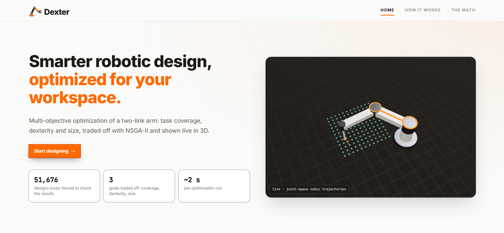
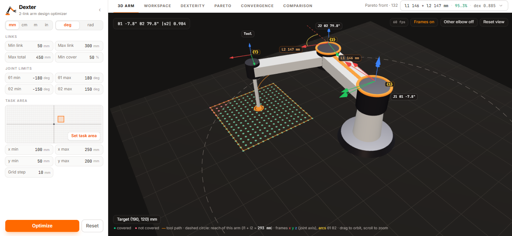
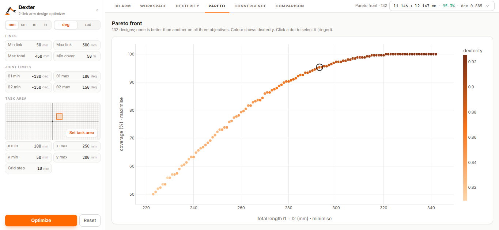
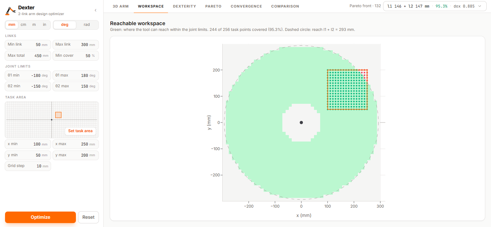

# Dexter

**Smarter robotic design, optimized for your workspace.**

Dexter finds the best link lengths (l1, l2) for a two-link planar robot arm. You draw up to four task areas the tool must reach, in any quadrant. NSGA-II then trades off three objectives, and the resulting designs are shown live in 3D:

- **Coverage** (maximise): the share of each area's task points the arm can reach within its joint limits, averaged over the areas. Every area must also reach the minimum coverage on its own.
- **Dexterity** (maximise): how far the arm stays from a singularity, |det J| / (l1·l2) = |sin θ2|.
- **Size** (minimise): the total link length l1 + l2.



## Features

- Task setup: link limits, joint limits and up to four drag-to-draw task areas, in mm, cm, m or in and in deg or rad.
- 3D arm view: coordinate frames, both elbow solutions, click-to-move along joint-space cubic trajectories, and a tour that moves the tool through every task area.
- Chart tabs: Workspace, Dexterity, Pareto front and Comparison.
- Explainer pages: How it works and The math.
- Results checked against a brute-force search of all 51,676 designs, for one task area and for two areas (see Validation).

## Screenshots

**3D arm view:** the selected design reaching a task point, with its coordinate frames and joint angles.



**Pareto front:** coverage against total length for every non-dominated design, coloured by dexterity.



**Workspace:** the area the tool can reach within the joint limits, over the task grid.



## How it works

1. **Define the task**: a grid of points the tool must reach, plus the allowed link and joint limits.
2. **Score each design**: inverse kinematics tests every task point with both elbow solutions. The Jacobian determinant rates the distance from a singularity.
3. **Optimize**: NSGA-II evolves 60 designs over 50 generations and keeps the ones no other design beats on all three objectives. These form the Pareto front.
4. **Explore**: pick a design from the front and inspect it in 3D and in the charts.

## Tech stack

| Part | Tools |
| --- | --- |
| Backend | Python, FastAPI, DEAP (NSGA-II), NumPy |
| Frontend | React, TypeScript, Vite, Tailwind CSS, React Three Fiber, Plotly |
| Tests | pytest, Vitest |

## Run it

**Backend** (runs on http://127.0.0.1:8000):

```bash
cd backend
python -m venv .venv
.venv\Scripts\activate          # macOS/Linux: source .venv/bin/activate
pip install -r requirements.txt
uvicorn main:app --reload
```

**Frontend** (runs on http://localhost:5173; it forwards API calls to the backend):

```bash
cd frontend
npm install
npm run dev
```

**Tests and validation:**

```bash
cd backend && pytest              # backend unit tests
cd backend && python validate.py  # NSGA-II vs brute-force true Pareto front
cd frontend && npm test           # frontend unit tests
```

## Validation

Link lengths are snapped to a 0.1 cm step, so every possible design can be evaluated: 51,676 arms per task. `validate.py` builds the exact true Pareto front by brute force and compares the NSGA-II result for 11 seeds.

| Task | True front | NSGA-II designs exactly on it | Average miss | Best coverage / shortest arm found |
| --- | --- | --- | --- | --- |
| One area (default) | 184 designs | 50.1% | 0.15 cm | 11 / 11 seeds |
| Two areas, far and near | 266 designs | 65.1% | 0.12 cm | 11 / 11 seeds |

The designs that miss the true front are about one length step away from it.

## Project structure

```
backend/
  robot/        kinematics, workspace, dexterity, fitness, optimizer, defaults
  main.py       FastAPI endpoints: /defaults /evaluate /optimize /ik /workspace
  validate.py   brute-force check of the optimizer
  tests/
frontend/
  src/components/   landing pages, task setup, 3D arm, chart tabs
  src/lib/          units, kinematics, trajectories, chart helpers
```

## Author

Kavish Srivastava
